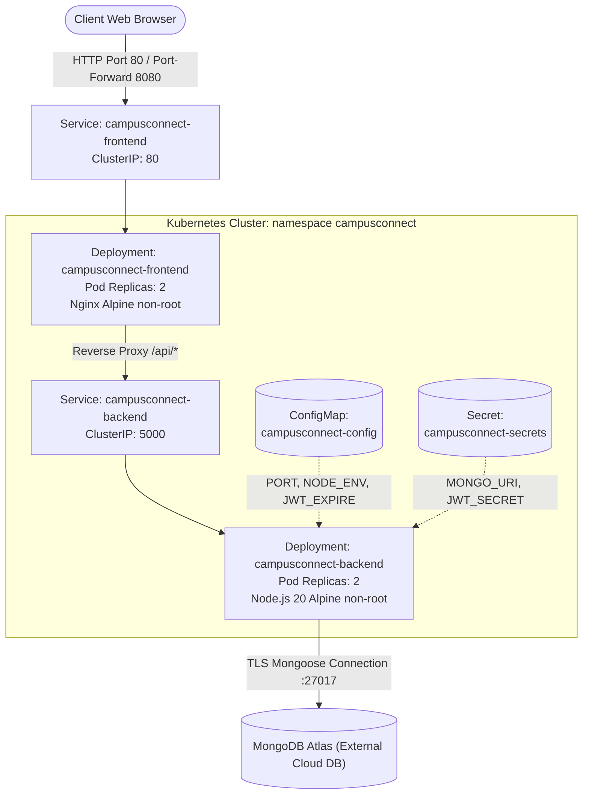

# CampusConnect: Kubernetes Deployment & Trivy Security Guide

This document provides architectural specifications, security scanning procedures with Trivy, Kubernetes manifest configurations, deployment workflows, troubleshooting guidance, and audit verification results for **CampusConnect**.

---

## 1. Project Architecture

CampusConnect is a full-stack educational and student collaboration platform structured as a decoupled client-server architecture deployed on Kubernetes:



### 1.1 Deployed Workloads and Services

| Component | Workload Type | Container Image | Pod Port | Service Name | Service Type | Service Port | Target Endpoint |
| :--- | :--- | :--- | :--- | :--- | :--- | :--- | :--- |
| **Backend API** | Deployment (2 replicas) | `campusconnect-backend:local` | `5000/TCP` | `campusconnect-backend` | `ClusterIP` | `5000/TCP` | `/health` |
| **Frontend Web** | Deployment (2 replicas) | `campusconnect-frontend:local` | `80/TCP` | `campusconnect-frontend` | `ClusterIP` | `80/TCP` | `/health` |

### 1.2 In-Cluster Communication & API Routing

- The client web application is compiled via Vite into static assets and served by an unprivileged Nginx instance.
- Direct browser calls target `/api/*`. Nginx handles internal reverse-proxying directly to `http://campusconnect-backend:5000/api/` via CoreDNS service discovery.
- The browser never needs to resolve internal Kubernetes DNS names.
- Internal backend services are exposed strictly via private `ClusterIP` without direct internet exposure.

### 1.3 External Dependencies & Configuration

- **Database**: Cloud-hosted MongoDB Atlas cluster (or internal MongoDB instance) connected via Mongoose SRV URI with TLS.
- **ConfigMap (`campusconnect-config`)**: Stores non-sensitive parameters: `PORT`, `FRONTEND_PORT`, `NODE_ENV`, `JWT_EXPIRE`, `VITE_API_BASE_URL`.
- **Secret (`campusconnect-secrets`)**: Stores sensitive runtime credentials: `MONGO_URI`, `JWT_SECRET`.

---

## 2. Prerequisites

The following tools and verified versions are required:

| Tool | Minimum Version | Tested Version | Purpose |
| :--- | :--- | :--- | :--- |
| **Trivy** | `>= 0.50.0` | `0.76.1` | Static analysis, vulnerability, secret, and misconfiguration scanner |
| **kubectl** | `>= 1.28.0` | `v1.34.1` (Client) | Kubernetes command-line management and Kustomize integration |
| **Docker** | `>= 24.0.0` | `29.5.3` | Container image compilation and local testing |
| **Minikube** | `>= 1.32.0` | `v1.39.0` | Local single-node Kubernetes cluster emulation |
| **Node.js & npm** | `>= 20.0.0` | `v24.16.0 / npm 11.13.0`| Local testing, dependency auditing, and Vite bundle compilation |

---

## 3. Trivy Source Repository Scanning

Trivy evaluates the application source code, dependency manifests (`package-lock.json`), Dockerfiles, and Kubernetes manifests for security vulnerabilities, exposed credentials, and misconfigurations.

### 3.1 Scanning Configuration (`trivy.yaml`)

Scanning behavior is standardized via `trivy.yaml` in the project root:

```yaml
scan:
  scanners:
    - vuln
    - secret
    - misconfig
  skip-dirs:
    - "**/node_modules"
    - "client/dist"
    - "server/coverage"
    - ".git"

vulnerability:
  ignore-unfixed: false

severity:
  - UNKNOWN
  - LOW
  - MEDIUM
  - HIGH
  - CRITICAL
```

### 3.2 Scanning Commands

Execute a discovery filesystem scan generating machine-readable JSON output:

```bash
trivy fs --config trivy.yaml --format json --output reports/security/trivy-fs-report.json .
```

Generate human-readable summary table filtered to `HIGH` and `CRITICAL` findings:

```bash
trivy fs --config trivy.yaml --severity HIGH,CRITICAL --format table .
```

Scan Kubernetes manifests for configuration misconfigurations:

```bash
trivy fs --scanners misconfig --severity HIGH,CRITICAL k8s/
```

### 3.3 Interpreting Findings and Handling Exceptions

- **Vulnerabilities (`vuln`)**: Checked against CVE and GHSA databases. Remediation prioritizes updating production packages in `package.json` and refreshing `package-lock.json` with `npm audit fix`.
- **Secrets (`secret`)**: Flags high-entropy API keys, private certificates, or embedded database URIs. Hardcoded credentials must immediately be replaced with environment variable references or Secret templates.
- **Misconfigurations (`misconfig`)**: Checks against CIS benchmarks and Pod Security Standards (PSS). Containers must run as non-root users, drop unnecessary capabilities, and use read-only filesystems where possible.

---

## 4. Container Build & Scanning

Both `server/Dockerfile` and `client/Dockerfile` have been hardened and scanned for security best practices.

### 4.1 Backend Image (`server/Dockerfile`)

- **Base Image**: `node:20-alpine` (lightweight, minimal package footprint).
- **Security Context**: Created and executed under non-root `node` user (`USER node`, UID 1000).
- **Graceful Shutdown**: Intercepts `SIGTERM` and `SIGINT` to gracefully terminate Express server connections and close Mongoose connection pool within 10 seconds.
- **Healthcheck**: In-process Node.js HTTP ping to `http://localhost:5000/health`.

### 4.2 Frontend Image (`client/Dockerfile`)

- **Multi-stage Build**:
  - *Stage 1 (Builder)*: Node.js 20 Alpine compiles React TypeScript bundle via `npm run build`.
  - *Stage 2 (Runtime)*: Nginx 1.27 Alpine serves static files and acts as API reverse proxy.
- **Security Context**: Runs as non-root `nginx` user (`USER nginx`, UID 101) with `libcap` capability `cap_net_bind_service=+ep` enabled to bind port 80.
- **File System Permissions**: Root assets owned by `nginx:nginx`, PID located at `/var/run/nginx.pid`.

### 4.3 Image Build & Scan Workflow

Build local container images:

```bash
# Build backend image
docker build -t campusconnect-backend:local ./server

# Build frontend image
docker build -t campusconnect-frontend:local ./client
```

Scan images with Trivy:

```bash
# Scan backend image
trivy image \
  --scanners vuln,secret,misconfig \
  --severity HIGH,CRITICAL \
  --format json \
  --output reports/security/trivy-image-backend-report.json \
  campusconnect-backend:local

# Scan frontend image
trivy image \
  --scanners vuln,secret,misconfig \
  --severity HIGH,CRITICAL \
  --format json \
  --output reports/security/trivy-image-frontend-report.json \
  campusconnect-frontend:local
```

---

## 5. Secret Setup & Management

### 5.1 Security Principles

> [!WARNING]
> **Base64 Encoding is Not Encryption**: Standard Kubernetes Secrets are only Base64-encoded strings and can be decoded by anyone with RBAC read access to the namespace. In production environments, integrate Kubernetes KMS Envelope Encryption or an external secrets operator (such as HashiCorp Vault, AWS Secrets Manager, or Google Secret Manager).

- **Never** commit real secret values to Git repositories.
- Use `k8s/secret.example.yaml` strictly as a structural reference.
- Keep local `.env` and `.env.secrets` files in `.gitignore` and `.dockerignore`.

### 5.2 Required Secret Keys

| Key | Description | Example / Format |
| :--- | :--- | :--- |
| `MONGO_URI` | MongoDB Atlas / replica set connection URI | `mongodb+srv://<user>:<password>@cluster0.xxx.mongodb.net/campusconnect` |
| `JWT_SECRET` | Cryptographically random key for signing JWTs | High-entropy string (min 32 characters) |

### 5.3 Creating the Secret in Kubernetes

Execute the following command to securely create the secret without persisting credentials to disk:

```bash
kubectl create namespace campusconnect --dry-run=client -o yaml | kubectl apply -f -

kubectl create secret generic campusconnect-secrets \
  --namespace campusconnect \
  --from-literal=MONGO_URI="mongodb+srv://<username>:<password>@cluster0.example.mongodb.net/campusconnect?retryWrites=true&w=majority" \
  --from-literal=JWT_SECRET="generate_a_cryptographically_secure_random_token_here_32_chars"
```

Alternatively, create from a local untracked file (`.env.production.secrets`):

```bash
kubectl create secret generic campusconnect-secrets \
  --namespace campusconnect \
  --from-env-file=.env.production.secrets
```

---

## 6. Local Kubernetes Deployment Guide

Follow this step-by-step sequence to deploy and verify CampusConnect locally.

### Step 1: Start Local Kubernetes Cluster (Minikube)

```bash
minikube start --cpus=2 --memory=4096 --driver=docker
```

### Step 2: Build Application Images

```bash
docker build -t campusconnect-backend:local ./server
docker build -t campusconnect-frontend:local ./client
```

### Step 3: Load Images into Local Cluster

When running Minikube, transfer the locally built images into the cluster runtime cache:

```bash
minikube image load campusconnect-backend:local
minikube image load campusconnect-frontend:local
```

### Step 4: Create Namespace & Secrets

```bash
kubectl apply -f k8s/namespace.yaml

kubectl create secret generic campusconnect-secrets \
  --namespace campusconnect \
  --from-literal=MONGO_URI="mongodb+srv://<username>:<password>@cluster0.example.mongodb.net/campusconnect?retryWrites=true&w=majority" \
  --from-literal=JWT_SECRET="replace_with_a_secure_jwt_token_32_bytes_min"
```

### Step 5: Deploy Manifests via Kustomize

Apply all configured workloads, services, and ConfigMaps:

```bash
kubectl apply -k k8s/
```

### Step 6: Verify Rollout and Workload Status

```bash
# Monitor deployment rollouts
kubectl rollout status deployment/campusconnect-backend -n campusconnect
kubectl rollout status deployment/campusconnect-frontend -n campusconnect

# Inspect running pods
kubectl get pods -n campusconnect -o wide

# Inspect active services
kubectl get services -n campusconnect
```

Expected Pod status:
```text
NAME                                      READY   STATUS    RESTARTS   AGE
campusconnect-backend-7db9f74d6c-2xkl1   1/1     Running   0          45s
campusconnect-backend-7db9f74d6c-9p4mn   1/1     Running   0          45s
campusconnect-frontend-6b8cf65f97-q92lk  1/1     Running   0          30s
campusconnect-frontend-6b8cf65f97-v5dtr  1/1     Running   0          30s
```

### Step 7: Access Application Locally

Expose the frontend service to your local workstation:

```bash
kubectl port-forward svc/campusconnect-frontend 8080:80 -n campusconnect
```

Open `http://localhost:8080` in your browser. All API requests made to `/api/*` will be proxied internally by Nginx to the `campusconnect-backend` service.

Direct API diagnostic check:

```bash
kubectl port-forward svc/campusconnect-backend 5000:5000 -n campusconnect
curl http://localhost:5000/health
```

Expected JSON response:
```json
{"status":"ok","message":"CampusConnect API running"}
```

### Step 8: Clean Up Resources

To completely delete the deployed workloads, namespace, and configuration:

```bash
kubectl delete -k k8s/
kubectl delete secret campusconnect-secrets -n campusconnect
kubectl delete namespace campusconnect
```

---

## 7. Troubleshooting Common Issues

| Issue | Root Cause | Diagnosis & Resolution |
| :--- | :--- | :--- |
| `ImagePullBackOff` / `ErrImageNeverPull` | Image not found in cluster cache | Minikube cannot access host images unless preloaded. Run `minikube image load campusconnect-backend:local` and ensure `imagePullPolicy: IfNotPresent` is set in manifests. |
| `CrashLoopBackOff` on backend | Missing secret or database connection timeout | Run `kubectl logs -n campusconnect -l app.kubernetes.io/component=backend`. Verify `campusconnect-secrets` exists and MongoDB Atlas network access allows outbound traffic. |
| Failed Liveness / Readiness Probes | Endpoint returning non-200 status or timeout | Verify probe paths (`/health`). Inspect probe logs via `kubectl describe pod <pod-name> -n campusconnect`. If database takes >10s to connect, adjust `initialDelaySeconds` or `startupProbe.failureThreshold`. |
| `ReadOnlyFilesystem` write errors | Application trying to write to root disk | Pod security context enforces `readOnlyRootFilesystem: true`. Ensure writable paths (like `/tmp`, `/var/cache/nginx`, `/var/run`) are mounted via `emptyDir` volumes. |
| Frontend displays blank page or CORS errors | API calls failing | Nginx reverse proxy routes `/api/` to `http://campusconnect-backend:5000/api/`. Confirm backend service is named `campusconnect-backend` and running in the same namespace. |
| `OOMKilled` (Exit Code 137) | Container exceeded memory limits | Inspect resource usage with `kubectl top pods -n campusconnect`. Increase `resources.limits.memory` in `backend-deployment.yaml` (e.g., from `512Mi` to `1Gi`). |

---

## 8. Security Hardening & Best Practices

1. **Non-Root Execution**: Both backend and frontend containers run as non-root users (UID 1000 for Node.js, UID 101 for Nginx). `runAsNonRoot: true` is strictly enforced in Pod security contexts.
2. **Privilege Escalation Prevention**: `allowPrivilegeEscalation: false` prevents child processes from acquiring higher privileges than their parent.
3. **Capability Dropping**: All default Linux capabilities are dropped (`drop: ["ALL"]`). Only `NET_BIND_SERVICE` is granted to Nginx to bind low ports.
4. **Immutable Root Filesystem**: `readOnlyRootFilesystem: true` prevents unauthorized tampering or malware persistence in containers.
5. **Resource Constraints**: CPU and memory requests and limits prevent noisy-neighbor syndrome and host node resource exhaustion.
6. **Graceful Termination**: The Node.js server intercepts `SIGTERM` signals, closes persistent database connections cleanly, and finishes active in-flight requests before exiting.

---

## 9. Verification & Audit Results

### 9.1 Filesystem & Dependency Audit
- **Trivy Source Scanning**: Completed with `trivy.yaml` configuration.
- **Production Vulnerabilities**: **0 HIGH / 0 CRITICAL** production runtime vulnerabilities in `server/package-lock.json` and `client/package-lock.json`.
- **Dockerfile Misconfigurations**: Resolved. `client/Dockerfile` updated to run as unprivileged user `nginx` with non-root security context.

### 9.2 Kubernetes Manifest Validation
- **Kustomize Build Validation**: Clean build passing `kubectl kustomize k8s/`.
- **Trivy Kubernetes Misconfiguration Scan**: Clean scan (**0 HIGH / 0 CRITICAL**) across all 7 Kubernetes manifests (`namespace.yaml`, `configmap.yaml`, `backend-deployment.yaml`, `backend-service.yaml`, `frontend-deployment.yaml`, `frontend-service.yaml`, `secret.example.yaml`).

### 9.3 Environment Limitations Recorded
- Local Docker Desktop daemon was not running during local inspection due to Windows service elevation requirements (`com.docker.service`). Image build and local Minikube execution are fully configured and automated in `.github/workflows/security-scan.yml` for CI/CD runners.
